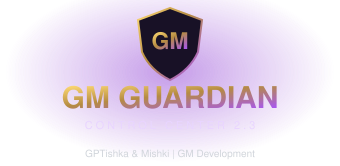
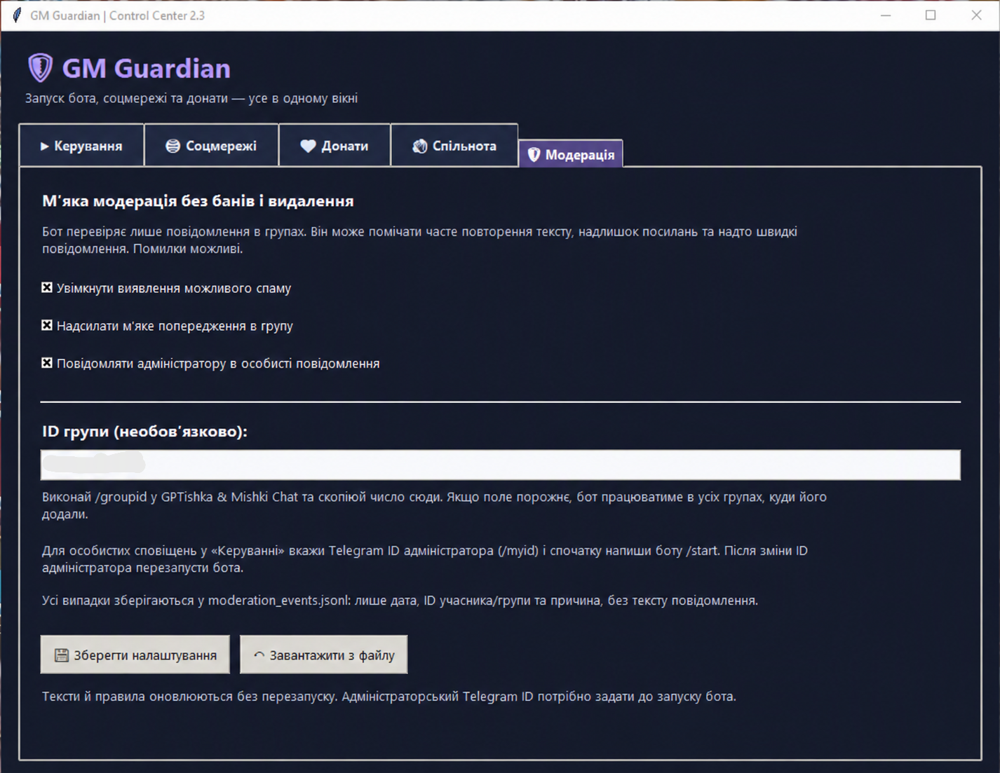
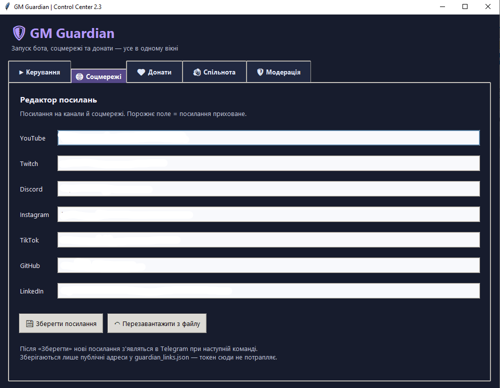
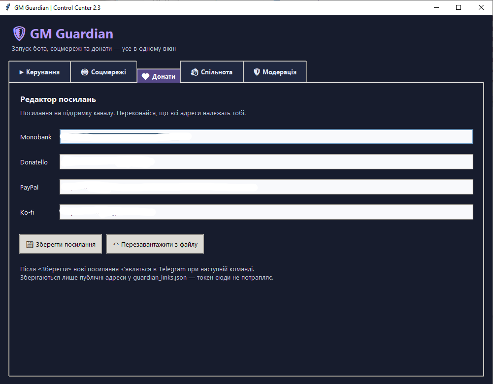
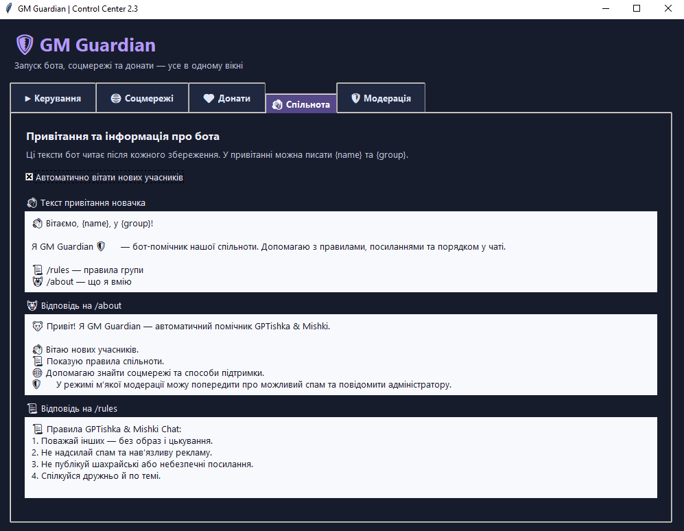

  

# 🛡️ GM Guardian — Control Center 2.3

### GPTishka & Mishki | GM Development

---

## 🇬🇧 About the project

GM Guardian is a custom Telegram bot with a graphical Windows Control Center, designed for community management, moderation and automation.

### Features

- Start, stop and restart the bot using a graphical interface.
- Automatic welcome messages for new members.
- Configurable community rules.
- Soft moderation and potential spam detection.
- Administrator notifications.
- Social media link management.
- Donation link management.
- Activity and moderation logs.
- Home server deployment.

---

## 🇺🇦 Про проєкт

GM Guardian — Telegram-бот із власною графічною панеллю керування, створений для автоматизації, модерації та розвитку онлайн-спільнот.

### Основні можливості

- Запуск, зупинка та перезапуск бота.
- Автоматичне привітання нових учасників.
- Редагування правил спільноти.
- Виявлення можливого спаму та флуду.
- М'яка модерація без автоматичних блокувань.
- Сповіщення адміністратора.
- Керування соціальними мережами.
- Налаштування посилань для донатів.
- Журнал роботи та подій модерації.
- Робота на домашньому сервері.

---

## 🇵🇱 O projekcie

GM Guardian to bot Telegram z własnym graficznym panelem sterowania dla systemu Windows, przeznaczony do zarządzania społecznością, moderacji i automatyzacji.

### Główne funkcje

- Uruchamianie, zatrzymywanie i restartowanie bota.
- Automatyczne powitania.
- Konfiguracja regulaminu społeczności.
- Wykrywanie potencjalnego spamu.
- Powiadomienia administratora.
- Zarządzanie linkami do mediów społecznościowych.
- Konfiguracja linków do wsparcia finansowego.
- Dziennik aktywności i moderacji.
- Praca na serwerze domowym.

---

## 🖥️ Interface & Screenshots

GM Guardian Control Center 2.3 — Windows graphical interface.

### 01. Control Center | Керування

Start, stop and restart the Telegram bot.

### 02. Social Media | Соцмережі

Manage social media links without editing the source code.

### 03. Donations | Донати

Configure financial support links.

### 04. Community | Спільнота

Customize welcome messages, community rules and bot information.

### 05. Moderation | Модерація

Configure soft moderation, spam detection and administrator notifications.

---

## ⚙️ Technologies

| Technology | Purpose |
|---|---|
| Python 3.14 | Application development |
| Telegram Bot API | Telegram integration |
| python-telegram-bot | Bot framework |
| Tkinter | Graphical user interface |
| JSON | Configuration management |
| Windows | Operating environment |
| GitHub | Project portfolio |

---

## 📊 Development status

- [x] Telegram bot
- [x] Graphical Control Center
- [x] Social media management
- [x] Donation management
- [x] Welcome messages
- [x] Soft moderation
- [x] Home server deployment
- [x] Technical documentation
- [ ] Automatic startup
- [ ] Automatic crash recovery

---

## 💼 Custom development

### 🇬🇧 English

Custom Telegram bot development is available upon request.

Individual functionality, graphical control panels, community management tools and automation solutions.

### 🇺🇦 Українська

Приймаю індивідуальні замовлення на розробку Telegram-ботів, графічних панелей керування та інструментів автоматизації.

Функціонал, дизайн і налаштування узгоджуються відповідно до потреб замовника.

### 🇵🇱 Polski

Tworzę indywidualne boty Telegram, graficzne panele sterowania i narzędzia automatyzacji na zamówienie.

Funkcjonalność, wygląd i konfiguracja są dostosowywane do potrzeb klienta.

> GM Guardian itself is a portfolio project and is not for sale.
>
> GM Guardian є демонстраційним проєктом і не продається.
>
> GM Guardian jest projektem demonstracyjnym i nie jest na sprzedaż.

---

## 🌐 Contact

- [GitHub](https://github.com/Boy-Mike)
- [Telegram](https://t.me/GPTishkaMishki)
- [YouTube](https://www.youtube.com/@GPTishkaMishki)
- [Instagram](https://www.instagram.com/gptishkamishki/)

---

## 🔒 Copyright & License

Copyright © 2026 Boy Mike B&M | GPTishka & Mishki — GM Development.

All rights reserved.

This repository is intended for portfolio and demonstration purposes only.

GM Guardian is a proprietary project. The application source code is not publicly distributed.

Unauthorized use, modification or commercial distribution of original protected materials is prohibited, except as permitted by applicable law or platform terms.

Third-party libraries remain subject to their respective licenses.

---

  <strong>🐻 GM Development</strong>

  Gaming • Software • Technology • Automation

  <strong>Boy Mike B&M.</strong>

